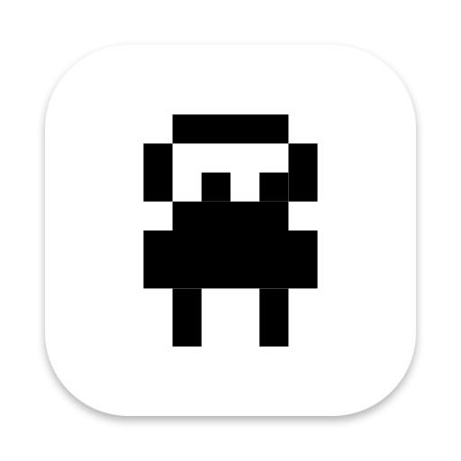
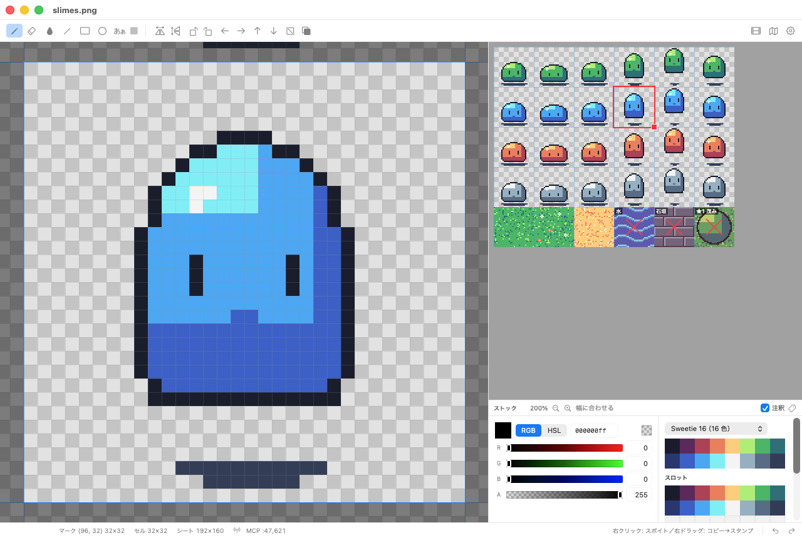

# Nanodot

ゲーム用スプライトシートを描くための macOS 用ドット絵ツールです。DotPainter ALFAR の操作体系（ストックとメインの往復、右ボタンの一貫した使い方）を参考にしています。仕様は [SPEC.md](SPEC.md) を参照してください。

[サイト](https://hashrock.github.io/nanodot/) · [ダウンロード](https://github.com/hashrock/nanodot/releases/latest)



## ビルドと起動

```sh
./scripts/build-app.sh      # リリースビルドして build/Nanodot.app を生成
open build/Nanodot.app
./scripts/release.sh        # Developer ID で署名・公証して dist/Nanodot-<版>.zip を作る（配布用）
```

- 必要なもの: macOS 14 以降、Xcode 16 以降（Swift 5.10+）
- 表示言語: 日本語・英語（システムの言語に従う。[表示言語](#表示言語)）
- テスト: `swift test`

### App Store 用ビルド

App Store 用のビルドには MCP サーバーを入れません（コード・待ち受け・設定の UI ごとコンパイルから外します）。直接配布（Developer ID）版は今までどおり MCP を含みます。

```sh
./scripts/build-app.sh --appstore                              # build/appstore/Nanodot.app を生成（arm64 + x86_64）
NANODOT_APPSTORE=1 swift test --scratch-path .build/appstore   # App Store 用の構成でテスト
./scripts/appstore.sh --check-only                             # ビルドして、App Store 用の条件を満たすか検査する
./scripts/appstore.sh                                          # 検査 → 署名 → dist/appstore/Nanodot-<版>.pkg
```

- `NANODOT_APPSTORE=1` を付けると `Package.swift` がコンパイル条件 `APPSTORE` を定義し、`#if !APPSTORE` で囲んだ MCP のコードが落ちます。
- App Sandbox を有効にして（`Resources/AppStore.entitlements`）ad-hoc 署名するので、手元で Sandbox 下の動作を確かめられます。書類は `open -a build/appstore/Nanodot.app <PNG>` で渡します（起動引数ではアクセス権が付きません）。
- 通常のビルドと成果物が混ざらないよう、`.build/appstore` でビルドします。
- `appstore.sh` の検査: MCP の文字列・シンボルがない、Network.framework をリンクしていない、Info.plist の項目、表示言語（ja・en の申告と訳の表。MCP の表は入っていない）、`PrivacyInfo.xcprivacy`、アイコン（1024×1024 まで）、App Sandbox と entitlements（`network.*` なし、決めたもの以外なし）。Apple とは通信しません。

### App Store に出す

`.pkg` の署名には次の 3 つが要ります（[Apple Developer](https://developer.apple.com/account/resources) で作ってこの Mac に入れる）。

1. 証明書 **Apple Distribution**（アプリの署名）
2. 証明書 **Mac Installer Distribution**（`.pkg` の署名。キーチェーンでは `3rd Party Mac Developer Installer: ...`）
3. App ID `com.hashrock.nanodot` の **Mac App Store Connect** 用プロビジョニングプロファイル。`Resources/Nanodot_AppStore.provisionprofile` に置く（リポジトリには入れません）か、`PROFILE=<場所>` で渡す

```sh
./scripts/appstore.sh                       # dist/appstore/Nanodot-<版>.pkg
xcrun altool --validate-app -f dist/appstore/Nanodot-<版>.pkg -t macos --apiKey <鍵の ID> --apiIssuer <発行者 ID>
xcrun altool --upload-app   -f dist/appstore/Nanodot-<版>.pkg -t macos --apiKey <鍵の ID> --apiIssuer <発行者 ID>
```

アップロードは Transporter アプリに `.pkg` をドロップしてもできます。同じ版（`CFBundleShortVersionString`）で出し直すときは、`Resources/Info.plist` の `CFBundleVersion` を上げます。

## 基本操作

| 操作 | メイン（拡大編集） | ストック（シート全体） |
|---|---|---|
| 左クリック／ドラッグ | ツールで描画 | マーク位置を指定 |
| 左ドラッグ（マーク内から） | — | 移動先と入れ替え |
| 左ドラッグ（マーク右下のつまみ） | — | ルーペサイズを変更 |
| 右クリック | スポイト | マーク大の範囲をコピー |
| 右ドラッグ | 範囲コピー → スタンプモード | コピー範囲を広げる |
| ダブルクリック | — | 貼り付け（⌥ で透明部分を抜く） |
| ホイール | 拡大縮小（ルーペサイズを 1/2・2 倍） | ホイールで拡大縮小（⌥ で縦・Shift で横に移動）。スクロールバーあり。トラックパッドは 2 本指で移動、ピンチで拡大縮小 |

| キー | 操作 |
|---|---|
| B (P) / E / G / L / R / O / T | ペン / 消しゴム / 塗りつぶし / 直線 / 矩形 / 楕円 / テキスト |
| 矢印（Shift） | マーク位置をスナップ単位（ルーペ単位）で移動 |
| ⌘C / ⌘V | マーク範囲をコピー / スタンプモード |
| Space + ドラッグ | メイン: マーク位置を動かす（セルの 1/8 単位）／ストック: 表示を動かす |
| Esc | スタンプモードを抜ける |
| Delete / ⌥Delete | マーク範囲を消去 / 描画色で塗りつぶし |
| ⌘Z / ⇧⌘Z | 取り消し / やり直し |
| ⌘' / ⌘0 | セルの格子の表示切替 / ストックを全体表示 |
| ⇧⌘A | アニメウィンドウ |
| ⇧⌘M | マップウィンドウ（仮組み） |

スナップ単位（既定はセルの 1/2）はメニュー「マーク > スナップ」で変えられます。

## MCP

直接配布版だけの機能です（App Store 用ビルドには入りません）。

AI エージェント（Claude Code など）から nanodot を操作できる MCP サーバーを内蔵しています。⚙ の設定で「MCP サーバー」をオンにし、`claude mcp add --transport http nanodot http://127.0.0.1:47621/mcp` で登録します。詳しくは [docs/MCP.md](docs/MCP.md) を参照してください。

## ファイル

画像は素の PNG で保存し、セル・スナップ・パレットスロット・アニメ・注釈・マップなどの設定は同じフォルダーの `<名前>.nanodot`（中身は JSON）に保存します。

- 以前の版が書いていた `<名前>.nanodot.json` も読めます。`<名前>.nanodot` があればそちらを優先します。保存は `<名前>.nanodot` だけに書き、古いファイルは消しません。
- App Store 版（App Sandbox）は、PNG の隣のファイルのうち `<名前>.nanodot` だけを読み書きできます。古い `<名前>.nanodot.json` は自動では読めないので、「ファイル > 設定を読み込む...」で選んで読み込みます。

ゲームエンジンがそのまま読めるデータは、「ファイル > ゲームエンジン用データを書き出す...」でフォルダーを選んで書き出します（保存のたびには書きません）。⌘E で前回の書き出し先にもう一度書き出せます。PNG と同じフォルダーに置くと、そのまま読めます。

- `<名前>.atlas.json`: アニメと名前付きセルのフレーム（Aseprite / TexturePacker 互換。Phaser の `load.aseprite` / `load.atlas` や Godot・Unity の Aseprite インポーターで読める）
- `<名前>.<マップ名>.tmj`: Tiled 形式のマップ（通行可否・重なり順・名前はタイルのプロパティ）

## 表示言語

日本語と英語で表示します。システムの言語（「システム設定 > 一般 > 言語と地域」。アプリごとの設定もそこ）に従います。優先する言語のどれにも日本語・英語がなければ日本語になります（`CFBundleDevelopmentRegion` が ja のため）。

元の言語は日本語で、コードに書いた文言がそのまま訳のキーになります。訳は `Resources/Localizable.xcstrings`（英語）に入っています。

- `Text("保存")` のように SwiftUI の部品へじかに書いたリテラルは、そのまま引かれます。
- SwiftUI を通らない文言（`String` を返す表示名、`NSAlert`、エラーの文面、取り消しの名前、三項演算子で選ぶ文言）は `L("…")` で包みます（`Sources/NanodotCore/Localization.swift`）。
- MCP まわりの画面の文言は `LM("…")` で、表は `Resources/MCP.xcstrings` です。App Store 用の `.app` には表ごと入れません。MCP のツールの説明・結果の文はエージェント向けなので訳しません。
- `Resources/InfoPlist.xcstrings` は Info.plist の書類の種類の名前です。

SwiftPM は `.xcstrings` をビルドできないので、`scripts/build-app.sh` が `xcstringstool` で `en.lproj/*.strings` にして `.app` の `Contents/Resources` に入れます（`Bundle.main` から引く。リソースバンドルは使いません）。`ja.lproj` は空の表で、日本語に対応していることを示すためのものです。Info.plist の `CFBundleLocalizations` で ja・en を申告しています。`swift run` のようにバンドルなしで動かすと、訳が見つからず日本語で出ます。

英語の画面を確かめるには:

```sh
./scripts/build-app.sh && open build/Nanodot.app --args -AppleLanguages "(en)"
```

**保存するデータには訳した文字列を入れません。**

| | 扱い | 例 |
|---|---|---|
| 設定に保存される、アプリが決めた名前 | 日本語のまま保存し、表示のときに `LName()` で訳す | 同梱パレットの名前（`緑の濃淡` → Green Shades） |
| 新しく作るものの既定の名前 | 作ったときの言語で決め、そのまま保存する（ユーザーが付けた名前と同じ扱い。開く環境の言語では変わらない） | `アニメ 1` / `Animation 1`、`マップ 1` / `Map 1`、`レイヤー 1` / `Layer 1`、`無題` / `Untitled` |
| 名前を変えた同梱パレット | 古い名前でも読める（`SamplePalette.renamed`）。読んだら今の名前にし、保存し直すと今の名前で書く | 0.4.0 までの `ゲームボーイ` → `緑の濃淡` |
| 名前のない古いデータを読むときの補い | 訳さない（どの言語で読んでも同じ値にする） | `マップ`、`レイヤー 1` |

アニメ・マップ・レイヤーの名前は、書き出すデータ（アトラスのタグ名、`.tmj` のファイル名とレイヤー名）にそのまま入るので、開いた環境の言語で変わっては困ります。そのため表示のときに訳すことはしません。

文言を足したら訳も足します。`scripts/check-localization.py` が、包み忘れ（訳が引かれない書き方）・訳の抜け・書式指定子の食い違い・使っていないキー・Localizable への MCP の文言の混入を見つけます。`build-app.sh`、`swift test`（`LocalizationTests`）、CI（`.github/workflows/check.yml`）から走ります。

## 構成

```
Sources/NanodotCore/   エンジン（UI 非依存、テスト可能）
  Pixel.swift          RGBA・矩形・画素バッファ（反転・回転・シフト・貼り付け）
  Raster.swift         直線・矩形・楕円・塗りつぶし
  Sheet.swift          スナップ、アニメ定義、サイドカーの設定
  Editor.swift         ドキュメント・マーク位置・履歴・ツール操作
  Localization.swift   訳を引く入口（L / LName / LM）
  SheetFile.swift      PNG とサイドカー（<名前>.nanodot）の読み書き、GIF・APNG・連番 PNG の書き出し
  EngineExport.swift   ゲームエンジン用（アトラス JSON・Tiled マップ）の書き出し
  SettingsMigration.swift  古い Bundle ID（dev.hashrock.nanodot）の設定の引き継ぎ
  TextRenderer.swift   文字をドットに描く
  TileMap.swift        マップの仮組み、セルの注釈
  MCP.swift / NanodotMCP.swift  MCP のメッセージ処理とツール
Sources/Nanodot/       macOS アプリ（SwiftUI パネル + AppKit のキャンバス）
  MainCanvasView.swift / StockView.swift / AnimPreviewView.swift
  Panels.swift (パレット・アニメ) / ContentView.swift / NanodotApp.swift
```
